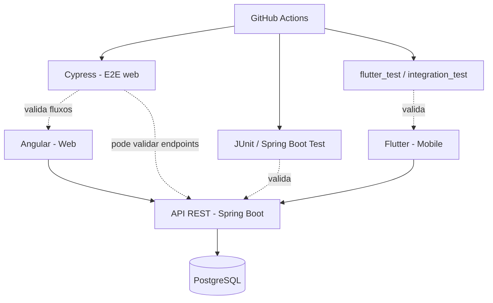

# DTPlan

> Aplicação web e mobile para organizar treinos e acompanhar registros de alimentação, desenvolvida com foco em desenvolvimento full stack e qualidade de software.


**DTPlan está em fase inicial de planejamento.** As tecnologias, funcionalidades e diagramas deste README representam a proposta atual do projeto; não significam que essas partes já estejam implementadas. O README será atualizado à medida que o desenvolvimento avançar.

## 📌 Visão do projeto

O DTPlan tem como objetivo reunir, em um só lugar, a organização de treinos e o registro da alimentação diária. A primeira versão será um MVP com escopo controlado, priorizando fluxos simples, consistentes e testáveis antes de expandir as funcionalidades.

Além do produto em si, este projeto é um espaço para demonstrar práticas de engenharia de software: planejamento de requisitos, arquitetura, APIs REST, testes automatizados, integração contínua e documentação técnica.

## 🎯 Objetivos

- Organizar rotinas de treino e exercícios.
- Registrar refeições e informações nutricionais disponíveis.
- Consultar um resumo diário dos registros.
- Oferecer uma experiência web e, posteriormente, mobile.
- Incorporar testes e critérios de qualidade desde o planejamento.
- Documentar decisões técnicas, desafios e aprendizados durante a evolução do projeto.

## 🧩 Escopo planejado para o MVP

### Treinos

- Criar e consultar rotinas de treino.
- Organizar exercícios por rotina.
- Registrar séries, repetições e carga, conforme o escopo validado.

### Alimentação

- Registrar refeições e alimentos consumidos.
- Exibir dados nutricionais quando essas informações estiverem disponíveis.

### Resumo diário

- Consultar os registros de treino e alimentação de um dia.

### Usuários e proteção de dados

- Planejar autenticação e separação dos dados por usuário antes de utilizar informações pessoais reais.

> O escopo poderá ser ajustado durante o desenvolvimento. O DTPlan tem foco em organização e acompanhamento; não substitui orientação médica ou nutricional e não pretende prescrever dietas ou tratamentos.

## 🛠️ Stack tecnológica planejada

| Camada | Tecnologia | Responsabilidade prevista |
|---|---|---|
| Backend | Java + Spring Boot | API REST, regras de negócio, validações e serviços |
| Banco de dados | PostgreSQL | Persistência dos dados |
| Frontend web | Angular | Interface web responsiva |
| Aplicativo mobile | Flutter | Experiência para dispositivos móveis |
| Testes E2E web | Cypress | Validar fluxos do usuário pela interface web |
| Testes de backend | JUnit + Spring Boot Test | Validar regras de negócio, serviços e integração com a API |
| Testes mobile | `flutter_test` e, conforme a evolução, `integration_test` | Validar widgets e fluxos do aplicativo Flutter |
| Integração contínua | GitHub Actions | Automatizar verificações e execução de testes |

### Estratégia de qualidade

A qualidade será incorporada progressivamente ao desenvolvimento:

- **Testes unitários:** validar comportamentos isolados e regras de negócio.
- **Testes de integração:** verificar a colaboração entre serviços, persistência e endpoints.
- **Testes E2E com Cypress:** cobrir fluxos prioritários da aplicação Angular.
- **Testes Flutter:** validar widgets e, quando necessário, cenários de integração mobile.
- **CI:** automatizar verificações para ajudar a identificar regressões.

O Cypress será usado principalmente para E2E web e poderá apoiar a validação de endpoints HTTP. Para o aplicativo Flutter, serão usadas as ferramentas de teste do próprio ecossistema Flutter.

## 🏗️ Arquitetura inicial

O desenho abaixo representa a arquitetura planejada, não uma implantação já concluída.



## 📂 Estrutura do repositório

A estrutura abaixo será preenchida conforme cada componente for implementado.

```text
dtplan/
├── dtplan-api/              # API Spring Boot
├── dtplan-web/              # Aplicação Angular
├── dtplan-app/              # Aplicação Flutter
├── dtplan-tests/
│   └── cypress/              # Testes E2E web
├── docs/
│   ├── requirements.md       # Requisitos e escopo do MVP
│   ├── architecture.md       # Decisões e desenho da arquitetura
│   ├── test-strategy.md      # Estratégia de testes
│   └── backlog.md            # Backlog inicial
├── infra/                   # Configuração de ambiente local
└── .github/
    └── workflows/            # Pipelines de CI, a configurar
```

## 📚 Documentação

- [Requisitos iniciais e escopo do MVP](docs/requirements.md)
- [Arquitetura inicial](docs/architecture.md)
- [Estratégia de testes](docs/test-strategy.md)
- [Backlog inicial](docs/backlog.md)

## 🚦 Roadmap

- [x] Criar a documentação inicial e definir a proposta do projeto.
- [x] Preparar a estrutura inicial do repositório.
- [ ] Revisar requisitos e critérios de aceite do MVP.
- [ ] Implementar a primeira fatia vertical de treinos no backend.
- [ ] Criar a interface Angular para o primeiro fluxo.
- [ ] Automatizar o fluxo principal com Cypress.
- [ ] Adicionar testes de backend e configurar integração contínua.
- [ ] Implementar registro de alimentação e resumo diário.
- [ ] Implementar os fluxos prioritários no Flutter.
- [ ] Documentar como executar localmente e demonstrar a aplicação.

## ▶️ Como executar

A aplicação ainda não possui uma versão executável. As instruções de instalação, configuração e execução serão adicionadas quando os componentes forem implementados.

## 💬 Feedback e contribuições

Este é um projeto pessoal de portfólio em evolução. Sugestões são bem-vindas: abra uma Issue na aba **Issues** do repositório, descrevendo a ideia, dúvida ou possível melhoria.

## 📄 Licença

A licença ainda será definida. Até que uma licença seja adicionada ao repositório, não presuma que o código está autorizado para reutilização, redistribuição ou uso comercial.
